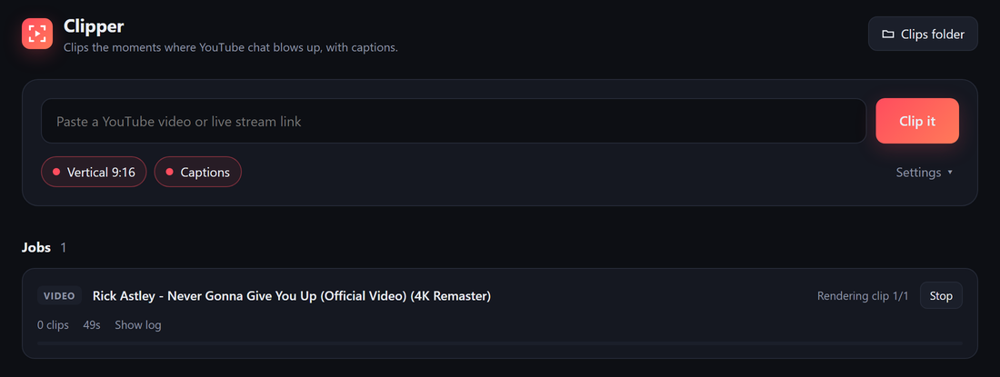
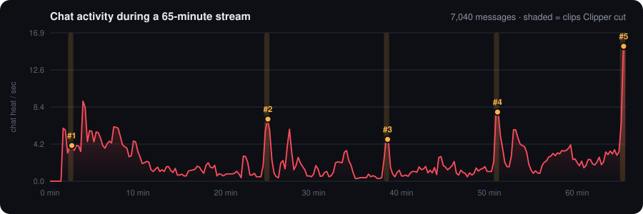
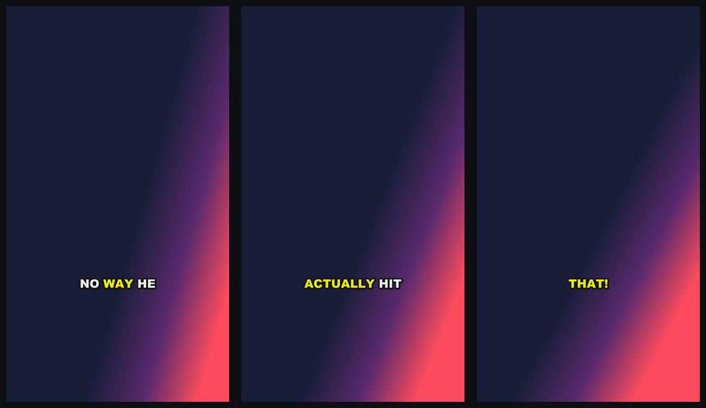

<div align="center">


# Clipper

**Turns the moments where YouTube chat blows up into captioned, vertical clips.**
Works on live streams as they happen, on past streams, and on normal videos.

[](https://github.com/Sonic-Bound/clipper/releases/latest/download/Clipper-windows-x64.zip)

[](https://github.com/Sonic-Bound/clipper/releases/latest)
[](LICENSE)




</div>

## What it does

Paste a YouTube link and press **Clip it**. Clipper finds the moments people reacted to, cuts them out, and burns in big word-by-word captions, ready for Shorts, TikTok or Reels.

| You paste… | Clipper watches… |
|---|---|
| 🔴 **A live stream** | Records the stream and reads the live chat in real time. Each time chat spikes, it cuts a clip, while the stream is still going. |
| 🎞️ **A past stream** | Downloads the full chat replay, finds the biggest spikes, and downloads only those few minutes, not the whole stream. |
| ▶️ **A normal video** | Has no chat, so it uses YouTube's *Most replayed* graph, or timestamps people mention in the comments ("4:12 💀"). |



<sub>Real chat from a 65-minute stream: Clipper picked the five spikes and cut the shaded windows. Chat reacts *after* something happens, so each clip starts 25 s before the peak.</sub>

### Captions that keep up

Speech is transcribed **on your PC** with Whisper, so nothing is uploaded anywhere. Captions appear 1–3 words at a time with the spoken word highlighted, pinned in place so they never bounce. Every clip also gets an `.srt` file.



## Install

1. **[Download Clipper-windows-x64.zip](https://github.com/Sonic-Bound/clipper/releases/latest/download/Clipper-windows-x64.zip)** (about 190 MB)
2. Right-click the zip → **Extract All…**, and put the folder wherever you like (e.g. `Documents\Clipper`).
3. Open the folder and double-click **`Clipper.exe`**.

Everything Clipper needs (Python, ffmpeg, yt-dlp, Whisper) is inside the folder; there is nothing else to install. Keep `Clipper.exe` next to its `_internal` folder.

> [!NOTE]
> **"Windows protected your PC"?** Clipper isn't code-signed (signing certificates cost money), so Windows SmartScreen warns about new downloads. Click **More info → Run anyway**. You only need to do this once.

> [!TIP]
> To add a Start-menu entry, right-click `Clipper.exe` → **Show more options → Pin to Start**.

**Requirements:** Windows 10 or 11 (64-bit), with the Microsoft Edge WebView2 runtime, which Windows 11 and up-to-date Windows 10 already have. An internet connection is needed for YouTube and for the one-time caption model download (a few hundred MB for the default quality) on your first captioned clip.

## Using it

- **Clips are saved in `Videos\Clipper`**, one folder per video. **Clips folder** in the app opens it.
- **Vertical 9:16** and **Captions** are on by default; click them to turn off.
- **Settings** sets how many clips to cut, sensitivity (higher catches smaller spikes), seconds before and after the peak, caption quality (Fastest → Best), and spoken language. Your choices are remembered.
- **Live streams** are watched until you press **Stop** or the stream ends. Clips that are in progress are finished first.
- **Delete** moves a clip to `Videos\Clipper\_deleted`, so you can get it back.
- Each job's **Show log** shows exactly what it is doing. If the app itself won't open, the reason is in `%LOCALAPPDATA%\Clipper\clipper.log`.

Caption speed depends on your PC: on a typical CPU, a 35-second clip takes a minute or two with *Balanced*, and *Fastest* is several times quicker. With an NVIDIA GPU (CUDA), it is much faster.

## How a "chat spike" is found

Every second of chat gets a heat score: one point per message, more for Super Chats and memberships, plus a bonus for hype (LOL, LMAO, KEKW, W, "clip it", 💀😂🔥, ALL CAPS). The score is smoothed over 10 seconds and compared with the stream's own normal level over the last 5 minutes, so a 50,000-viewer stream and a 200-viewer stream are each judged against themselves. A moment counts when it rises well above normal (a robust z-score of 3.5 by default; the sensitivity slider changes this).

On live streams, Clipper reads YouTube's full **Live chat** feed rather than the filtered *Top chat*. YouTube delivers live chat 10–20 s late, so a live clip is saved about half a minute after the moment happens.

## Run from source

```bash
git clone https://github.com/Sonic-Bound/clipper.git
```
```bash
cd clipper
```
```bash
python -m venv .venv
```
```bash
.venv\Scripts\python -m pip install -r requirements.txt
```

Then start the desktop app with `Clipper.bat`, or use the command line:

```bash
.\clip.bat "https://www.youtube.com/watch?v=VIDEO_ID"
```

<details>
<summary><b>Command-line options</b></summary>

```bash
.\clip.bat URL --horizontal                   # keep 16:9 (clips are 9:16 by default)
.\clip.bat URL -n 10 --pre 30 --post 15       # 10 clips, 30 s before / 15 s after the chat peak
.\clip.bat URL --dry-run                      # just list the moments, download nothing
.\clip.bat LIVE_URL --max-minutes 120         # watch a live stream for 2 hours
.\clip.bat URL --model medium --language hi   # better / non-English captions
```

| Option | Default | Effect |
|---|---|---|
| `--threshold` | 3.5 | lower = more clips, higher = only huge moments |
| `--min-rate` | 0.3 | ignore spikes slower than this many messages per second |
| `--min-gap` | 60 | minimum seconds between clips |
| `--skip-start` | 90 | ignore the "hi chat" flood at the start of a past stream |
| `--live-offset` | 3 | shift live clips earlier if they start too late |
| `--source` | auto | force `chat`, `heatmap` or `comments` |
| `--model` | small | `tiny`/`base` faster, `medium`/`large-v3` more accurate |
| `--no-captions` | | skip transcription |

From source, clips go to `clips/<title> [id]/` with a `clips.json` listing each clip's time range, score and a YouTube link to the moment. In PowerShell the `.\` before `clip.bat` is required.

</details>

<details>
<summary><b>Building Clipper.exe</b></summary>

```bash
.venv\Scripts\python -m pip install pyinstaller
```
```bash
.venv\Scripts\python -m PyInstaller Clipper.spec --noconfirm
```

The app ends up in `dist\Clipper`. It's a folder build on purpose: the app runs itself as a helper for every job and download, and a single-file exe would unpack ~460 MB to a temp folder each time. `install_shortcuts.py` adds Desktop and Start-menu shortcuts to it.

</details>

## Good to know

- Live mode keeps a temporary recording of the stream (about 2 GB per hour at 1080p) and deletes it when you stop.
- Clipping and reposting other creators' content may need their permission. Check the channel's rules and YouTube's Terms of Service.

## Built with

[yt-dlp](https://github.com/yt-dlp/yt-dlp) · [faster-whisper](https://github.com/SYSTRAN/faster-whisper) · [FFmpeg](https://ffmpeg.org) · [pywebview](https://pywebview.flowrl.com) · [FastAPI](https://fastapi.tiangolo.com) · [Deno](https://deno.com)

## License

[MIT](LICENSE). Free to use, change and share. The Windows download also bundles third-party programs under their own licenses, including FFmpeg (GPL v3); see [THIRD_PARTY_NOTICES.md](THIRD_PARTY_NOTICES.md).
